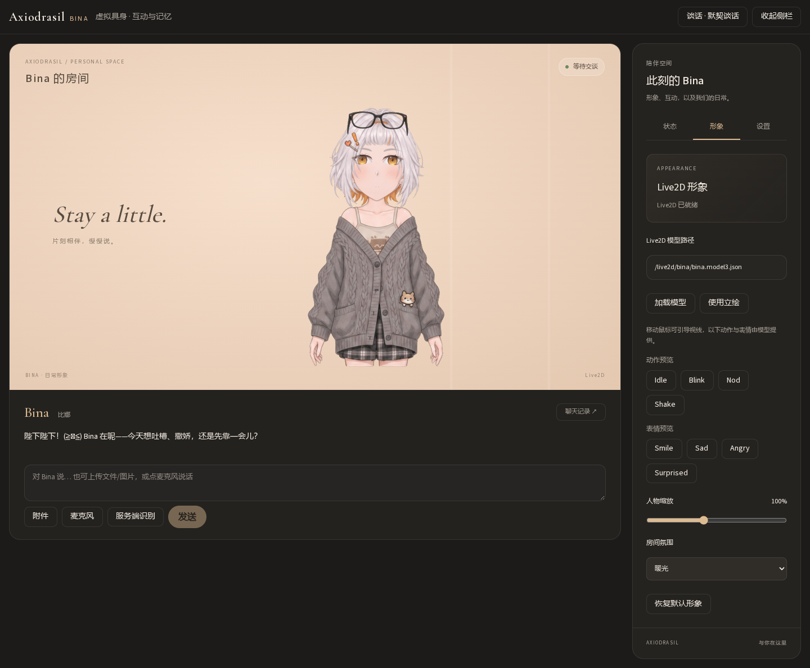

# Bina Live2D 第一版

以 `frontend/public/bina/casual.jpeg` 为外貌参考，通过 imagegen 生成透明分件图，再由 PSD2Live 3.6.7 自动绑定、导出。当前为自动制作的初版，分件边缘、转头轮廓与服装细节可继续在工程中精修。

## 文件

- `source/parts-atlas.png`：生成的原始 4×4 部件图。
- `source/parts/`：参与绑定的 15 个独立部件。
- `source/bina.layout.json`：部件位置、绘制顺序和语义标签。
- `source/assembled-preview.png`：绑定前的拼装预览。
- `bina.psd2live`：可继续编辑的 PSD2Live 工程。
- `bina.cmo3`、`bina.can3`：导出的 Cubism 工程与动画工程。
- `bina.psd2live.json`、`generation-report.json`：导出与参数记录。
- `browser-desktop.png`：浏览器中的实际页面截图。
- `browser-mobile.png`：手机尺寸下的实际页面截图。
- `browser-verification.json`：浏览器交互检查结果与资源响应记录。
- 网页运行资源位于 `frontend/public/live2d/bina/`，入口为 `bina.model3.json`。

## 重新打包素材

在仓库根目录执行，使用 Python 3.13：

```bash
.devstack/tools/uv pip install --python .venv/bin/python -r assets/bina-live2d/requirements.txt
.venv/bin/python scripts/prepare_bina_live2d.py
```

脚本按固定部件图裁切、对齐素材，生成 Layout 清单与拼装预览，不调用图片生成服务，也不重新绑定模型。

## 继续编辑

使用 [PSD2Live 3.6.7](https://github.com/tsunehimatoi/psd2live/releases/tag/v3.6.7) 打开 `bina.psd2live`。本次本地工具安装于 `.devstack/tools/psd2live/`，通过官方 `mcp_proxy.py` 连接 MCP 完成了导入、自动绑定、保存和导出。工具安装目录被 Git 忽略，不随仓库克隆。

Linux x86_64 便携版的安装命令（仓库根目录执行）：

```bash
mkdir -p .devstack/downloads .devstack/tools/psd2live
curl -fL https://github.com/tsunehimatoi/psd2live/releases/download/v3.6.7/PSD2Live-3.6.7-linux-x64.tar.gz -o .devstack/downloads/PSD2Live-3.6.7-linux-x64.tar.gz
curl -fL https://github.com/tsunehimatoi/psd2live/releases/download/v3.6.7/SHA256SUMS.txt -o .devstack/downloads/SHA256SUMS.txt
(cd .devstack/downloads && awk '$2 ~ /linux-x64.tar.gz$/ {print}' SHA256SUMS.txt | sha256sum -c -)
tar -xzf .devstack/downloads/PSD2Live-3.6.7-linux-x64.tar.gz -C .devstack/tools/psd2live --strip-components=1
curl -fL https://raw.githubusercontent.com/tsunehimatoi/psd2live/v3.6.7/mcp_proxy.py -o .devstack/tools/psd2live/mcp_proxy.py
```

需要启动独立 MCP 服务时，在仓库根目录运行：

```bash
.devstack/tools/psd2live/bin/PSD2Live mcp --port 23871 --store "$PWD/.devstack/psd2live-workspace" --profile full
```

该命令打印本次连接的令牌。另一个终端设置 `PSD2LIVE_MCP_TOKEN` 为该令牌后，可用官方代理操作；`--edit` 自动携带当前工程状态：

```bash
export NO_PROXY=127.0.0.1,localhost
.venv/bin/python .devstack/tools/psd2live/mcp_proxy.py call workspace_overview
.venv/bin/python .devstack/tools/psd2live/mcp_proxy.py call project_open '{"path":"/绝对路径/assets/bina-live2d/bina.psd2live"}' --edit
```

重新从素材创建工程时，使用 `project_import_layout` 导入 `source/bina.layout.json`，再调用 `rig_generate`。导出的文件名取自输入文件名，替换网页资源时同时核对 `.model3.json` 中的相对引用。

当前包含 20 个参数，4 组动作（Idle、Blink、Nod、Shake），4 种表情（Smile、Sad、Angry、Surprised）及头发物理。TTS 口型与聊天自动驱动尚未接入。

## 已完成的验收

2026-11-05，Chromium + 软件 WebGL：默认模型加载、待机画面变化、三组手动动作、四种表情、切换立绘后刷新、恢复默认模型、Live2D 选择刷新恢复、手机尺寸画布适配均通过，无页面异常。全部 12 个模型关联资源存在。

前端 Lint、TypeScript 检查与 `npx next build --webpack` 通过。默认 Turbopack 构建在当前环境遇到 Google Fonts 查询解析错误，具体运行方式见 [接入说明](../../docs/Bina_Live2D.md)。


