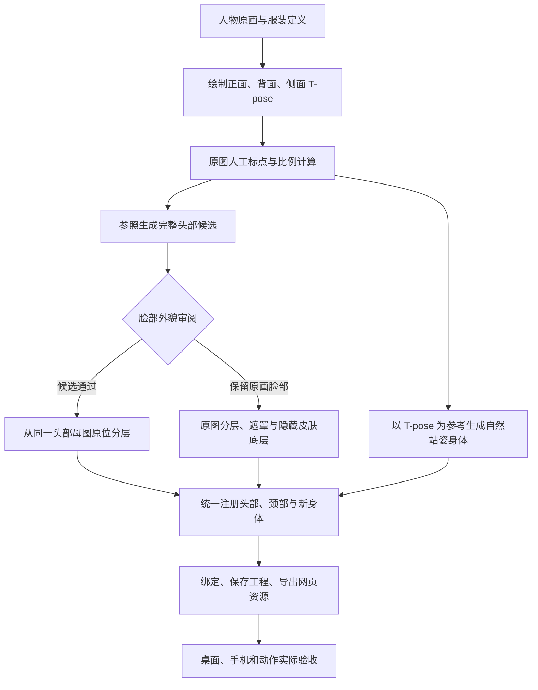

# Bina：从 T-pose 到自然站姿 Live2D 的完整流程

这份记录整理实际采用的制作方法、被否定的路线和可复用的操作。目标是先保证人物外貌和自然站姿，再把已认可的画面变成可编辑、可运行的 Live2D 模型。

依据是 [TraitYoung/alive-bina](https://github.com/TraitYoung/alive-bina) 的现有文件与本次工作区成果。相关提交包括 `9d6b607`（三视图）、`24dc859`（初版模型）、`9874d01`（比例测量）、`d30eba8`（分层返工），本次工作基于 `b8fabaa`。模型编辑使用 [PSD2Live 3.6.7](https://github.com/tsunehimatoi/psd2live/releases/tag/v3.6.7)，生成素材使用内置 imagegen。

## 流程总览



关键顺序：先确认完整画面，再拆层；比例约束生成，外貌仍靠原图对照；身体换姿势时重新绘制肩线和衣褶。

## 1. 绘制 T-pose 与三视图

先确定 Bina 的人物原画、服装与外貌定义，再以同一参考制作日常装和工作装的正面、背面、侧面。对应文件保存在 [T-pose 目录](../../assets/bina-tpose/README.md)，共六张。

正面是日常装模型的主基准。背面检查后发与衣服结构，侧面约束轮廓、前后厚度及服装层次。所有视图保留完整头顶、手部与鞋底；不能混用不同服装的遮挡骨点。

最初六张 T-pose 的完整生成提示词没有保存在现有记录中。Skill 的 [提示词模板](../../skills/reference-to-live2d/references/prompts.md) 是本次整理的复用模板，不冒充最初提示词。之后生成时应把实际提示词与原图一起保存。

## 2. 在原图上标点，再计算比例

原图、标点、尺寸、哈希和计算结果保存在 [proportions.json](../../assets/bina-tpose/measurements/proportions.json)。标点定义在 [measure_bina_tpose.py](../../scripts/measure_bina_tpose.py) 的 `LANDMARKS`，属于人工观察后计算，不是自动人体检测。

坐标采用原图像素，原点在左上角，x 向右、y 向下；这里 left/right 指画面左右。头高从头顶到下巴，不含呆毛和眼镜；全高含鞋底。看不见的骨点记为 `null`，不从衣摆推断真实腰线或裆部。

日常装正面实际数据：

| 项目 | 数值 |
| --- | --- |
| 画布 | 1536 × 1024 px |
| 头顶 | `(764, 28)` |
| 下巴 | `(765, 172)` |
| 鞋底标点 | y=1009 |
| 含鞋全高 | 981 px |
| 头高 / 头身数 | 144 px / 6.8125 |
| 脸颊宽 / 瞳距 | 79 px / 47 px |
| 单眼宽 / 开合高度 | 28 px / 12 px |
| 嘴宽 / 颈宽 | 22 px / 39 px |
| 衣物下肩关节估计宽 | 158 px |

正面五官估计误差约 ±2 px，身体可见轮廓约 ±4 px，宽松衣服下的肩关节约 ±10 px。肩关节估计不是衣服外缘。

```text
全高 H = sole.y - crown.y
头高 h = chin.y - crown.y
头身数 = H / h
统一缩放 s = 目标含鞋全高 / 原图含鞋全高
x' = 目标中线 + (原图 x - 原图中线) × s
y' = 目标头顶 y + (原图 y - 原图头顶 y) × s
```

五官还用脸宽和瞳孔中线归一化。禁止为迁就旧分件而分别拉伸脸、眼睛或头发；生成后必须重新观察，不能把提示词中的目标点当作生成结果的实际标点。

在仓库根目录复现原始六图报告：

```bash
.venv/bin/python scripts/measure_bina_tpose.py
```

该命令会重建 JSON、CSV、六张标注 SVG 与 HTML 报告。原图改变后先重新核对 `LANDMARKS`，不要只更新哈希。

## 3. 参照生成完整脸部，审阅后决定可见像素来源

曾尝试按比例独立生成五官、头发和身体，再把它们摆到目标坐标。该路线被否定：即使位置对齐，眼型、明暗、发丝关系和神态仍然改变，出现明显拼接感。对应 [source-measured](../../assets/bina-live2d/source-measured/README.md) 是失败对照。

随后以日常装正面为唯一身份参考，生成一张完整头部候选，让五官、发型、光影在同一母图中连续成立。实际 [头部提示词](../../assets/bina-live2d/head-revision/prompt.txt) 和 [候选图说明](../../assets/bina-live2d/head-revision/README.md) 已保存。该候选没有成为最终可见脸部，不能因文件名为 `head-master` 就误认为已采用。

本次最终采用原图原位分层：

1. 保留原画脸部、五官、头发与配饰的可见像素和相对位置。
2. 用 imagegen 生成前景遮罩与隐藏皮肤底层，实际提示词保存在 [prompts.txt](../../assets/bina-live2d/source-registered/prompts.txt)。
3. 在原始 1536 × 1024 画布上拆层，PNG 只裁切并记录偏移，不独立缩放五官。
4. 隐藏底层放在原图后面；修复遮罩误删的镜片后方头发和外轮廓白底溢出。
5. 复合后检查像素还原、脸部外貌和头发连续性。

原图分层产物共 24 层，见 [source-registered](../../assets/bina-live2d/source-registered/README.md)。其检查记录中的不透明像素 RGB 差异和不透明复合差异均为 0；这一结论针对原图分层，不延伸到重新生成的身体，也不代表大角度动画已无缝。

复现命令使用 Windows PowerShell 5.1 和 System.Drawing，在仓库根目录运行：

```powershell
powershell -NoProfile -ExecutionPolicy Bypass -File scripts/prepare_bina_registered.ps1
```

## 4. 用 T-pose 作参考，重新生成自然站姿身体

先前直接拆分并旋转 T 姿袖子、同时下移手部。即使修正了遮挡和自动 Glue 拉扯，肩膀仍保留横举时的角度，针织褶皱也不符合下垂状态。用户明确否定该方法，记录保存在 [rejected-standing-rotation.json](../../assets/bina-live2d/reference/rejected-standing-rotation.json)。

正确方式是以 T-pose 为设计和比例参考，生成新的完整自然站姿：肩线从颈部自然下倾，袖笼与落肩位置按下垂手臂重画，褶皱遵循重力，肘部与双手放松，同时保留原服装的针织、口袋、猫咪图案、裙子、袜套和鞋。

本次实际生成要求包括：原始画布 1536 × 1024、中线约 x=765、头顶约 y=28、下巴约 y=172、裙摆约 y=538、鞋底约 y=1010。它们是生成约束，不能代替对生成图的检查。

产物与提示词：

- [自然站姿母图](../../assets/bina-live2d/source-standing/standing-master-v1.png)。
- [实际完整提示词](../../assets/bina-live2d/source-standing/prompt.txt)。
- [素材说明](../../assets/bina-live2d/source-standing/README.md)与 [组装记录](../../assets/bina-live2d/standing-pose.json)。

生成器返回的 RGBA 原件原样保留。并排审阅完整站姿，确认肩线、袖子、双手和服装垂坠自然后，才进入模型组装。

## 5. 原图头部与新身体组装

为了保持已经认可的 Bina 外貌，最终身体母图里的生成头部被移除，保留原图的 16 个头部、头发、五官与颈部图层。复制后的头部/颈部 PNG 与原图分层文件逐文件 SHA-256 一致。

颈部必须单独核对。第一次只保留头部时出现透明细缝，补回原画颈部图层后修复。身体注册不能靠拉伸头部来弥补。

PSD2Live 3.6.7 的实际顺序：

1. `project_import_layout` 导入 [source-standing/bina.layout.json](../../assets/bina-live2d/source-standing/bina.layout.json)。
2. `rig_generate` 生成网格与现有参数体系。
3. 对 `standing_master` 执行 `source_split_polygon`，按 `standing-pose.json` 的 `generated_body_polygon` 保留 `standing_body`。
4. `layer_delete` 删除 `generated_head_reference`，保留原图头部/颈部层。
5. 查看静态全身与颈部连接；删层后必要时给渲染工具显式传入保留图层 ID，避免引用已删除层。
6. 保存 `bina-registered.psd2live` 并导出 `.cmo3`、`.can3` 及网页资源。

当前身体为一块连续网格，支持整体呼吸和身体运动；独立手臂动作尚未绑定。以后需要挥手时，应从已认可的新站姿拆层并补齐肩部/袖口遮挡区，再建立独立控制，而不是恢复 T 姿旋转方案。嘴部作为 `face/detail` 保留原画闭嘴轮廓，没有口腔内层。

## 6. 网页接入与验收

当前入口为 `frontend/public/live2d/bina-registered/bina.model3.json`。工具导出默认使用 `bina.layout` 前缀，打包为 `bina` 时同步替换 JSON 相对引用。12 个关联资源均检查存在。

前端旧路径 `/live2d/bina/bina.model3.json` 会迁移到新版；用户主动选择的静态立绘继续保留。内置模型还使用小幅转头、视线与头发运动校正，不能以限幅代替自然肩部母图。

已在真实网页检查：默认加载、路径迁移、刷新、Blink/Nod/Shake、四种表情、手机画布、切回立绘后的保持；没有页面异常，关联资源 HTTP 状态正常。

- [桌面截图](../../assets/bina-live2d/registered-browser-desktop.png)。
- [手机截图](../../assets/bina-live2d/registered-browser-mobile.png)。
- [浏览器检查记录](../../assets/bina-live2d/registered-browser-verification.json)。
- [导出记录](../../assets/bina-live2d/registered-generation-report.json)。

前端有代码改动时运行 `npm --prefix frontend run lint` 和 `npm --prefix frontend run build`。只更新模型素材时，重点检查引用与浏览器画面，不重复无关后端测试。当前运行页为 `http://127.0.0.1:3000/solo`。

## 可复用 skill

仓库版入口：[reference-to-live2d/SKILL.md](../../skills/reference-to-live2d/SKILL.md)。包含阶段决策、提示词模板、Bina 路径映射和可复用的比例计算脚本。安装到本机 skill 目录后可调用：

```text
$reference-to-live2d 参照这个人物的原画和 T-pose，制作保留外貌的自然站姿 Live2D。
```

Skill 应从当前已认可阶段继续工作；它不要求每次重画所有素材，也不授权推送 GitHub 或发布模型。
